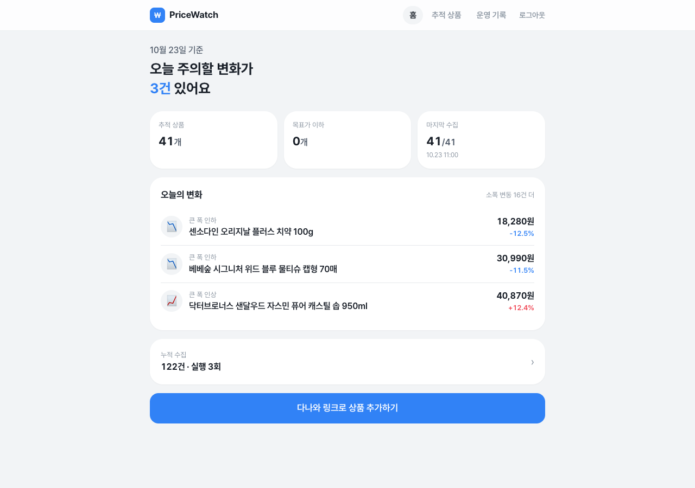
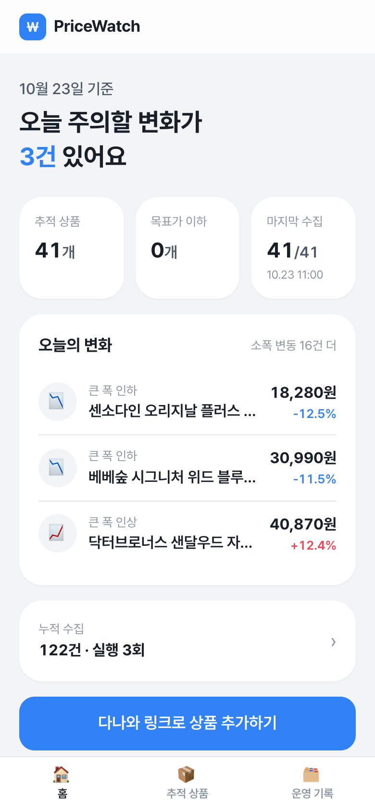
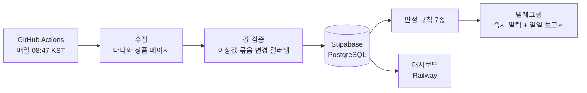
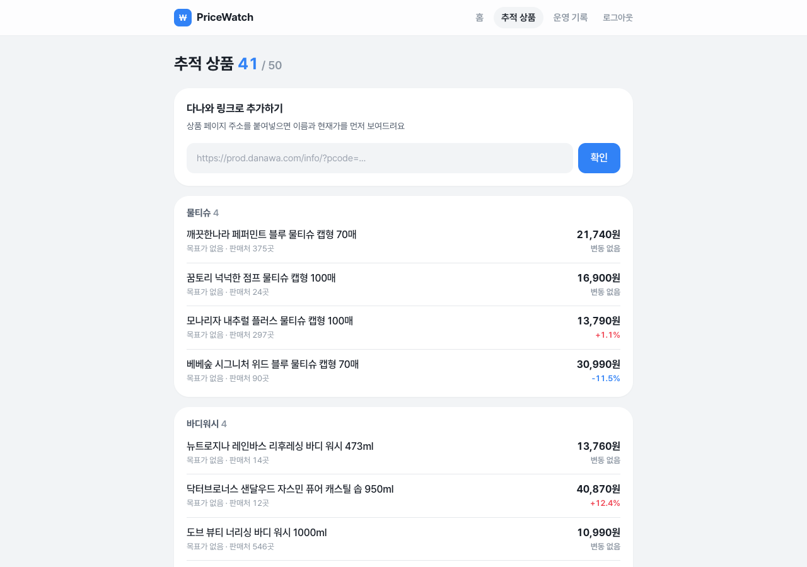
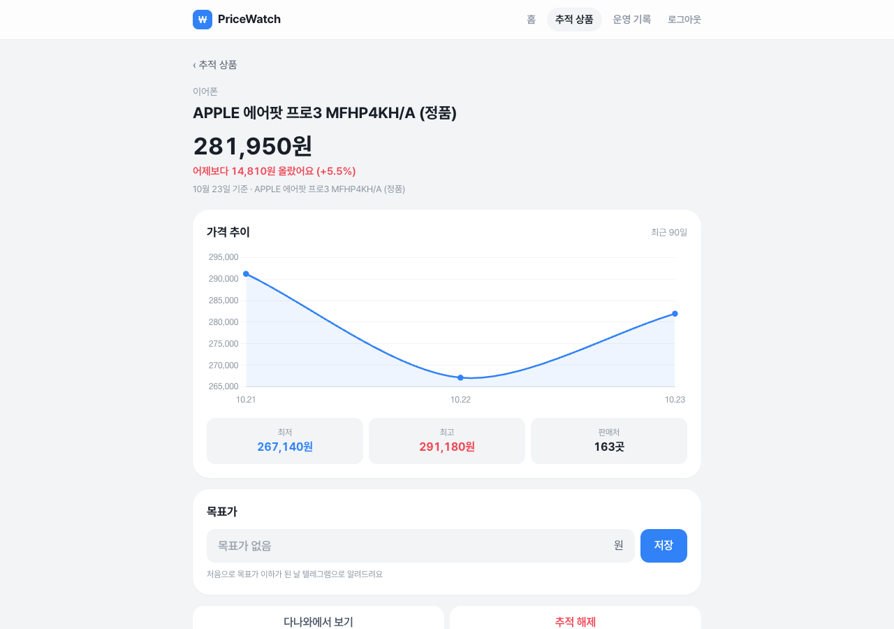
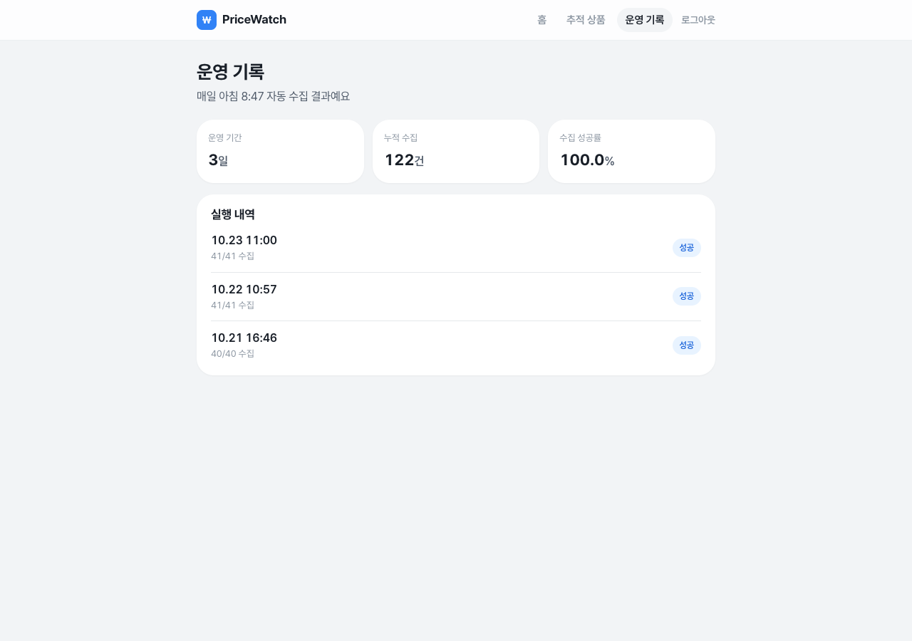

# PriceWatch

경쟁 상품 가격을 매일 자동으로 수집·비교해서, 변동과 목표가 도달을 알려주는 가격 모니터링 자동화 시스템입니다.

> **데모:** https://web-production-b130ef.up.railway.app (로그인 필요)
> **매일 실행 기록:** [GitHub Actions](https://github.com/lcr0605/pricewatch/actions/workflows/daily.yml)

<p>
  
  
</p>

## 자동화하는 업무
| | 내용 |
|---|---|
| **자동화 전** | 담당자가 매일 다나와에서 상품을 하나씩 검색 → 최저가·판매처 수를 엑셀에 옮겨 적고 어제와 비교 → 보고 (하루 1~2시간) |
| **자동화 후** | 매일 아침 자동 수집·비교 → 중요한 변동만 텔레그램 알림 + 일일 보고서. 담당자는 읽고 대응만 결정 |

## 운영 현황 (2026-10-23 기준)
| 항목 | 수치 |
|---|---|
| 운영 기간 | 3일 (2026-10-21 시작) |
| 실행 | 3회, 모두 성공 |
| 누적 수집 | 122건, 수집 성공률 100% |
| 추적 상품 | 41개 (생활용품 10개 분류 × 4 + 이어폰 1) |
| 즉시 알림 | 5건 (목표가 도달 1, 큰 폭 인하 3, 큰 폭 인상 1) |
| 테스트 | 79개 통과, PR마다 자동 실행 |
| 운영 비용 | 유료 API 없음. 기존 Railway 요금제 안에서 대시보드 1개 |

운영하며 생긴 문제와 대응은 [docs/ops-log.md](docs/ops-log.md)에 날짜별로 기록합니다.

## 동작 흐름


1. **수집:** 상품 상세 페이지의 검색엔진용 데이터(JSON-LD)에서 최저가·판매처 수·평점을 읽음. 없으면 화면 가격 사용
2. **검증:** 100원 미만이나 전일 대비 70% 넘게 변한 값은 저장하지 않음. 다나와가 대표 묶음 옵션(예: 칫솔 30개 → 10개)을 바꾼 날은 비교에서 제외
3. **판정:** 아래 규칙으로 변화를 골라 중요도 순으로 정렬
4. **알림:** 급한 것은 바로, 나머지는 일일 보고서 한 통으로. 하루 실패율이 30%를 넘거나 실행 자체가 실패하면 점검 알림

### 판정 규칙
| 규칙 | 조건 | 알림 |
|---|---|---|
| 목표가 도달 | 목표가 이하로 **처음** 내려간 날 | 즉시 |
| 큰 폭 인하·인상 | 전일 대비 ±10% 이상 | 즉시 |
| 30일 최저가 | 7일 이상 쌓인 뒤 30일 중 최저 | 보고서 |
| 판매처 급감 | 판매처 30% 이상 감소 (품절 신호) | 보고서 |
| 우리 가격 경쟁력 | 우리 판매가가 최저가보다 5% 넘게 비쌈 (마진 함께 표시) | 보고서 |
| 소폭 변동 | 10% 미만 변동 | 보고서 |
| 묶음 변경 | 가격 기준 옵션이 바뀜 → 비교 불가로 표시 | 보고서 |

## 대시보드
| 추적 상품 | 상품 상세 | 운영 기록 |
|---|---|---|
|  |  |  |
| 다나와 링크를 붙여넣으면 미리보기 → 목표가 제안(현재가 -5%) → 추적 시작 | 가격 추이 차트, 목표가 수정, 추적 해제 | 실행 내역, 누적 수집, 성공률 |

- 토스 스타일 (인상 빨강, 인하 파랑), 모바일 우선
- 보안: 모든 화면 로그인 필수(5회 실패 시 1분 잠금), CSRF 방지, 서명된 세션, 배포 서버 쿠키 `Secure`, API 문서(`/docs`) 비공개

## 기술 구성
| 영역 | 사용 |
|---|---|
| 언어 | Python 3.11 |
| 수집 | requests, BeautifulSoup (JSON-LD 우선) |
| DB | Supabase PostgreSQL, SQL 직접 작성 (모든 테이블 RLS) |
| 대시보드 | FastAPI, Jinja2, Tailwind, Chart.js |
| 알림 | 텔레그램 봇 |
| 매일 실행 | GitHub Actions 예약 실행 (중복 실행 방지: 당일 성공 기록 확인 + PostgreSQL advisory lock) |
| 배포 | 대시보드 Railway (main 병합 → 테스트 통과 후 자동 배포) |
| 테스트 | pytest, 테스트 중 외부 네트워크 요청 차단 |

## 운영하며 해결한 문제
- **가짜 급락 판정:** 첫 수집에서 다나와 최저가가 상품마다 대표 묶음 옵션 기준인 것을 발견 → 옵션 이름을 함께 저장하고 바뀐 날은 비교 제외
- **오해를 부르는 보고서 문구:** 첫날 비교할 데이터가 없는데 "변동 없음"으로 출력 → "비교 불가"로 구분
- **Railway 전체 장애(10/21~):** 매일 수집을 GitHub Actions로 이전, 대시보드는 임시로 다른 서비스에 올렸다가 복구 후 다시 이전
- **자동 배포 미동작:** 배포 설정에 트리거가 빠져 있던 것을 API로 확인해 수정. 테스트 통과 후에만 배포되게 설정
- **배포 후 점검:** 로그인 쿠키에 `Secure`가 빠진 것을 발견 → 배포 서버에서만 켜지도록 수정
- **예약 실행 지연:** 08:47 예약이 실제로는 약 2시간 늦게 시작 → 관찰 중. 중복 실행 방지 장치가 있어 시각 변경·실행 환경 이전이 안전

자세한 내용: [운영 기록](docs/ops-log.md)

## AI(Claude Code) 활용
개발은 Claude Code로 진행하고, 작업마다 **맡긴 일 / 요구사항으로 준 조건 / 검토하며 고친 점 / 테스트 결과**를 기록했습니다. 모든 변경은 브랜치 → PR → 테스트 통과 → 병합 순서로 진행합니다.

예시
- 테스트가 실제 다나와에 요청하던 버그 발견 (함수 기본값이 정의 시점에 고정됨) → 수정하고 테스트 중 외부 요청 차단 장치 추가
- 스크린샷 점검으로 모바일 입력창이 찌그러지는 문제 발견 → 수정하고 디자인 규칙에 명시

자세한 내용: [AI 활용 기록](docs/ai-log.md)

## 실행
```bash
python3.11 -m venv .venv && source .venv/bin/activate
pip install -r requirements.txt
cp .env.example .env   # DATABASE_URL 입력
pytest -q
python -m app.products search 샴푸
python -m app.products add "https://prod.danawa.com/info/?pcode=97405013" 280000   # 링크로 추적 시작
python -m app.run_daily
uvicorn app.web.main:app --reload   # 대시보드 http://localhost:8000
```

## 수집 정책
비영리 포트폴리오 용도이고, 하루 1회·소량만 수집하며 robots.txt 금지 경로는 사용하지 않습니다. 자세한 내용은 [docs/collection-policy.md](docs/collection-policy.md)에 있습니다.
